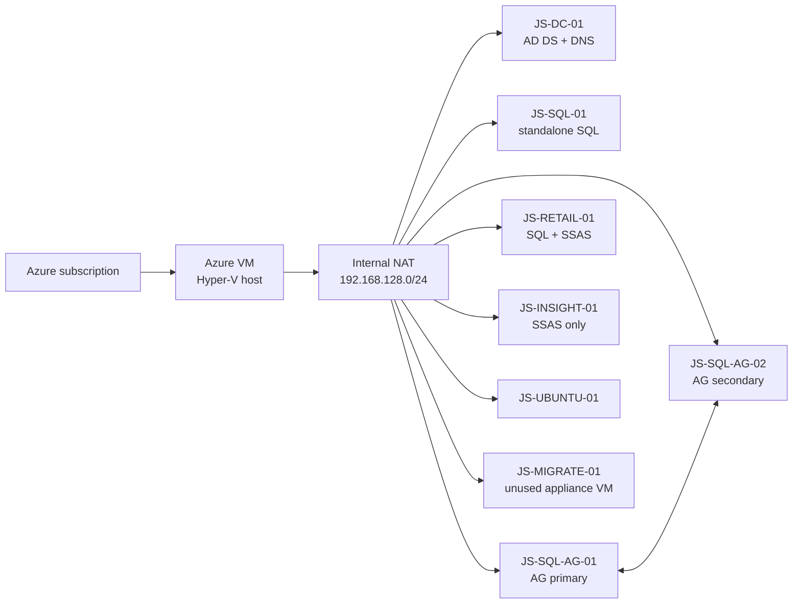

# Arc Jumpstart v2

**Clone this repo and ask your agent: "Help me use this to make an Arc environment."**

After collecting the required Azure target, cost, and credential decisions,
your agent should create and verify the complete environment without further
intervention. It should run through the domain, SQL installations, cluster,
availability group, sample databases, and Arc launcher staging.
Before deployment, the agent asks whether to use default SQL Developer or your
own pre-keyed SQL Server 2025 Standard and Enterprise ISOs. The licensed path
with new media storage has one earlier, intentional handoff: after the host and private storage are
ready, upload with the host's desktop helper or put both ISOs directly in the
configured Blob container root. The agent guides the chosen route and the
continuation validates the uploads and creates a missing manifest automatically.
Developer mode needs no media handoff.

The agent stops before adding the servers to Azure Arc because that step
requires you to authenticate with your own Azure identity. Open the staged
launcher on each server and complete the device-code sign-in. The Arc-enabled
SQL Server extension should then deploy automatically and inventory the SQL
instances and databases. When the Arc machine and SQL resources are healthy,
the environment is ready for the assessment, modeling, and migration workshop
exercises.

## Optional guided skill

For a more consistent agent workflow, preview and install the repository's
`arc-jumpstart` skill with GitHub CLI 2.90.0 or later:

```text
gh skill preview markgar/arc-jumpstart arc-jumpstart
gh skill install markgar/arc-jumpstart arc-jumpstart --agent github-copilot --scope user
```

`gh skill` is in public preview. Preview skills before installing them. Start a
new Copilot session or run `/skills reload`, then ask:

```text
Use /arc-jumpstart to help me build this lab.
```

The skill is optional. The repository scripts and runbooks remain the source of
truth.

## What this builds

The lab creates an Azure-hosted Windows Server 2025 Hyper-V environment that
an agent prepares for:

1. User-authenticated Azure Arc onboarding.
2. Azure Migrate assessment and Resource Graph inventory modeling.
3. A simple migration of one database to Azure SQL Managed Instance.



By default, the agent prepares the domain, four SQL Server 2025 Enterprise Developer
Database Engine instances, two SSAS Tabular instances (without models), sample
relational databases, WSFC, availability group, listener, Arc resource
group, host-only SSMS 22 and desktop launchers. SSMS installation runs
independently after the numbered stages by default; on an existing host, use
`./scripts/deploy.ps1 ssms` to install or verify it without replaying `all`.
The user then opens the launcher and authenticates
with their own Azure identity. The workshop starts after Arc inventory is ready:
perform or reuse an assessment, export modeling data, and migrate
`JumpstartStandaloneDB` to a small SQL managed instance.

**Building the environment could take 2 hours.** Actual time varies with
downloads and any required recovery. See the
[measured build duration](docs/00-agent-bootstrap.md#measured-build-duration).
The optional [read-only build dashboard](scripts/README.md#read-only-build-dashboard)
shows stage evidence, parallel preparation, guest readiness and captured recovery
history in a browser or Copilot Browser canvas, without another Azure polling loop.

This is a disposable evaluation environment. The default outer host is
`Standard_E16s_v7` in `westus2`, with a 1 TiB Premium SSD and optional Azure
Bastion. Review current Azure pricing, quota, licensing, and auto-shutdown
before deployment.

| Guest | Workload | Virtual cores | Startup RAM |
|---|---|---:|---:|
| `JS-DC-01` | AD DS and DNS | 2 | 4 GiB |
| `JS-SQL-01` | SQL Database Engine only | 6 | 8 GiB |
| `JS-SQL-AG-01` | SQL AOAG replica | 6 | 8 GiB |
| `JS-SQL-AG-02` | SQL AOAG replica | 6 | 8 GiB |
| `JS-RETAIL-01` | SQL Database Engine + SSAS | 4 | 8 GiB |
| `JS-INSIGHT-01` | SSAS only, no Database Engine | 4 | 4 GiB |
| `JS-UBUNTU-01` | Linux | 2 | 4 GiB |
| `JS-MIGRATE-01` | Unused workgroup Windows VM, reserved for the Migrate appliance | 8 | 16 GiB |

The eight guests have 38 assigned virtual cores and 60 GiB startup RAM on the
16-vCPU / 128-GiB host. `INCLUDE_APPLIANCE_VM=false` omits the reserved VM.
It uses an 80-GiB disk, the internal switch and DHCP; no appliance software,
SQL, domain join, or Arc launcher is installed there. Later appliance installation
and project registration are separate user actions. Microsoft's
[Hyper-V script requirements](https://learn.microsoft.com/en-us/azure/migrate/deploy-appliance-script)
include Windows Server 2025, 8 vCPUs, 16 GB RAM and approximately 80 GB disk.
SSAS uses
the same non-production Developer media by default; no SSIS or sample BI models are
installed. SSAS discovery and assessment coverage must be verified separately
from relational SQL inventory; see the [assessment guide](docs/04-assessment.md).

For authorized, pre-keyed SQL Server 2025 Standard and Enterprise ISOs,
`SQL_EDITION_MODE=licensed` uses private Blob storage and pauses after host
creation for user media upload, either through the desktop launcher or directly
to the configured container root. Standard is assigned to standalone
and BI guests; Enterprise to the two full-AG replicas. Developer never pauses
for an ISO upload. See the [private-media workflow](scripts/README.md#licensed-sql-media).
Both new image preparation and licensed SQL installation still need live
clean-build acceptance; local regression results are not that proof.
If authorized SQL media is already stored for another lab, approve its reuse
and set both `SQL_MEDIA_RESOURCE_GROUP` and `SQL_MEDIA_ACCOUNT_NAME`. The new
lab references the existing account without changing its settings or uploads,
adds its own private connection and read access, verifies the existing media,
and continues without another upload handoff.
For a fresh OS-only trial that does not wait for licensed SQL media, use the
saved [`configure-installation-media.ps1` and `deploy.ps1 os-only` path](scripts/README.md#preparing-a-fresh-installation-media-trial).

## Prerequisites

- An Azure subscription and interactive Azure CLI user with the permissions in
  [`docs/01-prerequisites.md`](docs/01-prerequisites.md).
- PowerShell 7 and Azure CLI (including `az bicep install`) on Windows, macOS,
  or Linux. WSL2 is not required.
- A private configuration file outside the repository.

Run the PowerShell entry points from this checkout on Windows, macOS or Linux.
See the [workstation prerequisites](docs/01-prerequisites.md#workstation).

## Configure and build

From a PowerShell 7 terminal in the repository root, create a private
configuration template in the visible `ArcJumpstart` folder in your home
directory, outside the repository:

```powershell
$env:ENV_FILE = $null # Clear a previous lab's override before creating a new file.
./scripts/init-config.ps1 -ResourceGroupRoot rg-arc-jumpstart-v2
```

The command creates `$HOME/ArcJumpstart/<root>.env` and records
`RESOURCE_GROUP_ROOT`. `rg-arc-jumpstart-v2` is a suggested default; choose
another root with `-ResourceGroupRoot`. At runtime the scripts derive
`AZURE_RESOURCE_GROUP=<root>-infra` and `ARC_RESOURCE_GROUP=<root>-arc`;
the suffixes are fixed.
For the example, the file is `rg-arc-jumpstart-v2.env` and the groups are
`rg-arc-jumpstart-v2-infra` and `rg-arc-jumpstart-v2-arc`.
It prints the absolute path without
showing its contents and never overwrites an existing file. Edit that file to replace every `CHANGEME`.
Set `$env:ENV_FILE` to its absolute path before running the remaining commands;
the same path must be used for all of them.
If you have deleted a previous lab and are rebuilding the same approved target,
you may reuse its existing private file and credentials after verifying that
the old resources are gone. Do not rerun `all` to repair a still-promoted
domain. For a second lab alongside the first, use a distinct private file and
pair of resource groups; pass a distinct root with `-ResourceGroupRoot`.
`init-config.ps1` also accepts
an explicit absolute `ENV_FILE` path and never overwrites it. Existing filenames
remain supported; no configuration files or Azure resource groups are renamed.
Before creating resources, `deploy.ps1 all` checks both target groups in the
configured subscription and refuses to proceed if either already exists.
Use scoped recovery for an existing lab, not `all`.

| Credential | Setting |
|---|---|
| Azure host/Bastion | `HOST_ADMIN_USERNAME`, `HOST_ADMIN_PASSWORD` |
| Nested Windows local Administrator and `JUMPSTART\Administrator` | `NESTED_WINDOWS_PASSWORD` |
| Directory Services Restore Mode | `SAFE_MODE_PASSWORD` |
| SQL domain service account | `SQL_SERVICE_ACCOUNT_PASSWORD` |
| SQL Server Authentication, login `sa` (all four engines) | `SQL_SA_PASSWORD` |

Passwords are not printed after creation. Record the private `ENV_FILE` path;
do not commit the file or recover secrets from deployment logs.
New nested Windows guests always use `JS123!!`, a public lab-only password.
Host, DSRM and SQL service passwords must remain unique and strong.
`init-config.ps1` generates one private 52-character `SQL_SA_PASSWORD` per new
lab. All four Database Engines install in mixed mode with `sa` enabled and use
that same password, while retaining Windows administrator access. SSAS does not
use `sa`. The shared password is lab-only, distinct from other credentials and
never printed. From host SSMS, choose **SQL Server Authentication**, login
`sa`, the guest IP with port `1433`, **Mandatory** encryption and **Trust server
certificate** for the lab certificate; your Bastion Windows account is unrelated.
See [host SQL connections](docs/02-deploy.md#connect-to-nested-sql-from-the-host).

Run:

```powershell
$env:ENV_FILE = Join-Path $HOME 'ArcJumpstart/rg-arc-jumpstart-v2.env'
az login
./scripts/validate.ps1
./scripts/preflight.ps1 infra
./scripts/deploy.ps1 all
```

Only start each command after the preceding one succeeds. Keep deployment
running in its own terminal; request one status snapshot when needed:

```powershell
./scripts/lab.ps1 build-status
```

Do not start a second deployment because the first terminal is quiet. For
recovery, rerun only the failed stage and required successors—never rerun
`all` against an already promoted domain.

## Use the lab

### Find your lab configuration and passwords

Your `<root>.env` file contains the lab configuration and passwords. For new labs,
use the visible `ArcJumpstart` folder, not a hidden folder. At the end of setup,
the agent must explicitly give you the **actual full path**, plus instructions
for finding and opening your file. Do not share or commit its contents.

| Platform | Usual full path (replace the example username) | Find and view the file |
|---|---|---|
| macOS | `/Users/alex/ArcJumpstart/rg-arc-jumpstart-v2.env` | In Finder, choose **Go > Home**, then open **ArcJumpstart**. Right-click the `.env` file and choose **Open With > TextEdit** to view it. |
| Windows native PowerShell | `C:\Users\alex\ArcJumpstart\rg-arc-jumpstart-v2.env` | Paste `C:\Users\alex\ArcJumpstart` into File Explorer's address bar, then open the `.env` file with Notepad. Use the actual path printed by `init-config.ps1`. |
| Windows with WSL2 | `/home/alex/ArcJumpstart/rg-arc-jumpstart-v2.env` inside WSL; `\\wsl.localhost\Ubuntu\home\alex\ArcJumpstart\rg-arc-jumpstart-v2.env` in Windows for an Ubuntu distro | Paste the folder path `\\wsl.localhost\Ubuntu\home\alex\ArcJumpstart` into File Explorer's address bar and press Enter. Right-click the `.env` file and open it with Notepad to view it. Use the actual distro and username supplied by the agent. |
| Linux | `/home/alex/ArcJumpstart/rg-arc-jumpstart-v2.env` | Open **Home > ArcJumpstart** in your file manager and open the `.env` file in a text editor. |

These are examples, not a way to locate an existing lab automatically. If you
already use a different `ENV_FILE`, keep using that exact file; do not overwrite
or silently move it. The agent must report its actual location instead. On
macOS, **Finder > Go > Go to Folder** also accepts the full containing folder
path. For native Windows PowerShell, `init-config.ps1` restricts the folder and
file to your account; for WSL, edit the file inside WSL and retain mode `600`.
If deployment runs on a remote execution host, the file is on that host, not
necessarily your laptop; the handoff must identify the host and how to access it.

### Learner guides

- [Deployment, access, and SSMS](docs/02-deploy.md)
- [Complete user-authenticated Arc setup](docs/03-arc-onboarding.md)
- [Azure Migrate assessment](docs/04-assessment.md)
- [Customer Arc inventory: one query and one CSV export](docs/04-customer-arc-inventory.md)
- [Migrate one database to SQL Managed Instance](docs/05-migration.md)
- [Troubleshooting, shutdown, and cleanup](docs/06-troubleshooting-cleanup.md)

Agent and implementation references:

- [Agent bootstrap and readiness contract](docs/00-agent-bootstrap.md)
- [Infrastructure stages](infra/README.md)
- [Script commands](scripts/README.md)
- [Domain-controller runbook](docs/02-domain-controller.md)
- [SQL AG lessons and recovery boundaries](docs/02-sql-ag-lessons.md)
- [Clean-room evidence and remaining gaps](docs/02-clean-room-lessons.md)

The optional legacy VHDX files are external Microsoft Jumpstart artifacts and are not
redistributed here. Stage `40` generalizes the Windows parent before cloning;
stage `45` installs SQL from verified Microsoft media. See the prerequisites
and troubleshooting guide before changing images, media, or licensing.

## Build without the Jumpstart images

The default `IMAGE_MODE=installation-media` path downloads official Windows and
Ubuntu installation ISOs and builds local Hyper-V disks on the outer host.
It does not use the Jumpstart VHDX endpoints or require image uploads.
SQL is installed separately: Enterprise Developer by default, or licensed
Standard/Enterprise using the independent private SQL-media storage.

In the private environment file, set:

```text
IMAGE_MODE=installation-media
WINDOWS_SERVER_VERSION=2025
INCLUDE_APPLIANCE_VM=true
WINDOWS_ISO_URL=https://go.microsoft.com/fwlink/?linkid=2345730&clcid=0x409&culture=en-us&country=us
WINDOWS_ISO_SHA256=auto
LINUX_SSH_PUBLIC_KEY=<your OpenSSH public key, not your private key>
```

The Linux inventory guest is optional. Set `INCLUDE_LINUX=false` for a
Windows-only lab: Ubuntu downloads, installer preparation, and guest creation
are omitted, and no Linux SSH key is required. Existing labs default to
including Linux. This does not bypass any Windows readiness or licensing gate.

Obtain Windows media through the
[Microsoft Evaluation Center](https://www.microsoft.com/en-us/evalcenter/download-windows-server-2025),
including its registration and evaluation terms. Use the English x64 ISO;
the builder selects Datacenter Evaluation with Desktop Experience, build 26100.
`NESTED_WINDOWS_PASSWORD=JS123!!` is the fixed lab-only Windows guest password.
The host independently uses the regular Azure Marketplace
`MicrosoftWindowsServer:WindowsServer:2025-datacenter-g2:latest`
image; no custom Azure host image is built or needed.
This is the ordinary non-Hotpatch Gen2 Datacenter image, preserving manual
patching and deliberate restarts on the Hyper-V host.
Existing configurations without `WINDOWS_SERVER_VERSION` continue to select
Server 2022 and do not gain an appliance VM. For a deliberate legacy Jumpstart
build, select `WINDOWS_SERVER_VERSION=2022` and `IMAGE_MODE=jumpstart`;
its externally maintained VHDX is not a Server 2025 image.
The Ubuntu 22.04.5 server ISO URL and checksum are supplied in
`deploy.env.example`; existing configuration files must add those two settings.
Windows downloads directly on the Azure host, restricted to official Microsoft
HTTPS redirects, with Microsoft Setup-signature verification and a recorded
SHA-256 fingerprint checked on cache reuse. `auto` works only with this exact
source; custom sources require an approved checksum. The fingerprint is not a
separately published Microsoft checksum.
No ISO is downloaded to the workstation. The normal validation, preflight,
and deployment commands are unchanged.

Windows Evaluation expires after 180 days and requires internet activation.
The build checks activation and remaining evaluation time; it never rearms or
converts editions. Ubuntu uses `jumpstart` with your SSH public key; password
login is disabled. Reach its private address through the host or approved
private connectivity. The host generates a separate restricted verification key.
These disks contain no preinstalled Arc agent or SQL Server.

**This is an experimental path until a fresh Azure build passes every readiness
gate through stage `60`.** Previous VHDX-based results do not prove this path.
See [image preparation and recovery](scripts/README.md#installation-media-images)
for cache locations, extra dependencies, and safe retry boundaries.
